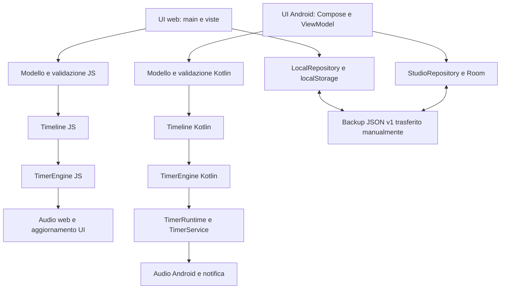

# Architettura e percorso di un comando

Tabata Timer ha due applicazioni con le stesse regole e dati interoperabili. Il web usa HTML, CSS e moduli JavaScript nativi, senza compilazione della UI. Android è un'app Kotlin con Jetpack Compose e Room. Non è una WebView del sito. Il sito pubblico ospita file statici; nessun server esegue i timer o conserva gli allenamenti.

## I quattro livelli

| Livello | Responsabilità | Confine da conservare |
| --- | --- | --- |
| Presentazione | Campi, pulsanti, anteprima, navigazione, lingua, tema | Non decide quali pause inserire contando i componenti sullo schermo |
| Dominio | Validazione, normalizzazione, timeline, conteggio e aggregati | Non dipende da DOM, Activity, rete o database |
| Persistenza | Lettura/scrittura, importazione, checkpoint Android | Non cambia le regole temporali per adattarsi al formato di archivio |
| Integrazione piattaforma | Web Audio, service worker, SoundPool, foreground service e notifica | Il successo o fallimento di un suono non decide quanti millisecondi sono trascorsi |

La duplicazione del piccolo dominio in JavaScript e Kotlin è intenzionale: permette un sito leggero e un servizio Android nativo. Le fixture comuni e i test di interoperabilità ne mantengono allineati i risultati. Non si introduce un backend soltanto per condividere queste funzioni.

## Dal pulsante Avvia a una sessione registrata

1. La schermata contiene una bozza. Workout imposta durate in secondi; Studio converte i minuti dei campi in secondi del modello. Il titolo del programma è distinto dai nomi delle attività.
2. Avvia valida il modello e compila la timeline. I programmi precedenti vengono normalizzati **su una copia**, con eventuale avviso: l'originale nell'archivio non viene riscritto da un'anteprima.
3. `TimerEngine` prende una copia del programma e riceve un orologio monotono. Parte dalla preparazione fissa di 20 secondi, identificata dall'indice `-1` e separata dalle fasi pianificate.
4. Ogni aggiornamento calcola il tempo passato dall'ultimo riferimento. Se il chiamante è in ritardo, il motore attraversa tutte le fasi scadute; non sottrae semplicemente un secondo a ogni callback.
5. UI, conto alla rovescia e suoni leggono lo stesso stato. L'identificativo della visita di fase distingue un nuovo ingresso dal semplice ridisegno della schermata.
6. Pausa consuma prima il tempo fino al comando e poi ferma lo stato. Ripresa cambia il riferimento monotono: il tempo in pausa non finisce nelle statistiche. Salta non accredita lavoro non svolto. Precedente permette di ripetere senza duplicare il conteggio degli intervalli completati.
7. Fine naturale o Termina producono un solo risultato, con ID e titolo copiati al momento della sessione. L'archivio aggiunge o aggiorna quel risultato per ID. Android usa anche checkpoint e transazione finale; il web conserva il risultato secondo la scelta di persistenza dell'utente.

## Tempo di calendario e tempo trascorso

Il timestamp ISO UTC serve per ordinare cronologia, esportare e aggregare per data. L'orologio monotono serve per misurare durate: `performance.now()` sul web e `SystemClock.elapsedRealtime()` su Android. Un cambio dell'orario del dispositivo non deve allungare il timer.

`plannedMs` è la somma delle fasi compilate, senza preparazione. `elapsedMs` misura il tempo attivo realmente consumato, lavoro e recuperi inclusi, senza pausa manuale. `workMs` include soltanto WORK. Tornare indietro può aumentare il tempo svolto; non aumenta artificialmente il numero di intervalli unici completati.

## Stato temporaneo e dati durevoli

Una bozza dell'editor non equivale a un programma salvato. Sul web la prima esecuzione può rimanere in RAM; il salvataggio locale è esplicito e gli errori di quota vengono segnalati. Android persiste i programmi nel database locale e recupera un checkpoint come attività interrotta dopo la morte del processo. Nessuna piattaforma trasferisce automaticamente i dati all'altra.

Lingua, tema, palette e ultima modalità sono preferenze del dispositivo/origine. I programmi e la cronologia contengono invece il campo modalità e vengono filtrati in raccolte separate. Il backup include entrambe le modalità; le preferenze restano locali.

## Dove cercare un difetto

Una durata sbagliata già in anteprima indica modello, normalizzazione o compilazione della timeline. Un'anteprima corretta con consumo errato indica il motore o il suo orologio. Un suono ripetuto con tempo corretto indica i tracker dei segnali. Un dato perso dopo riapertura indica persistenza o origine browser. Un controllo Android che agisce sul timer successivo indica l'identità della sessione nella notifica. Questa separazione permette verifiche piccole e mirate.
